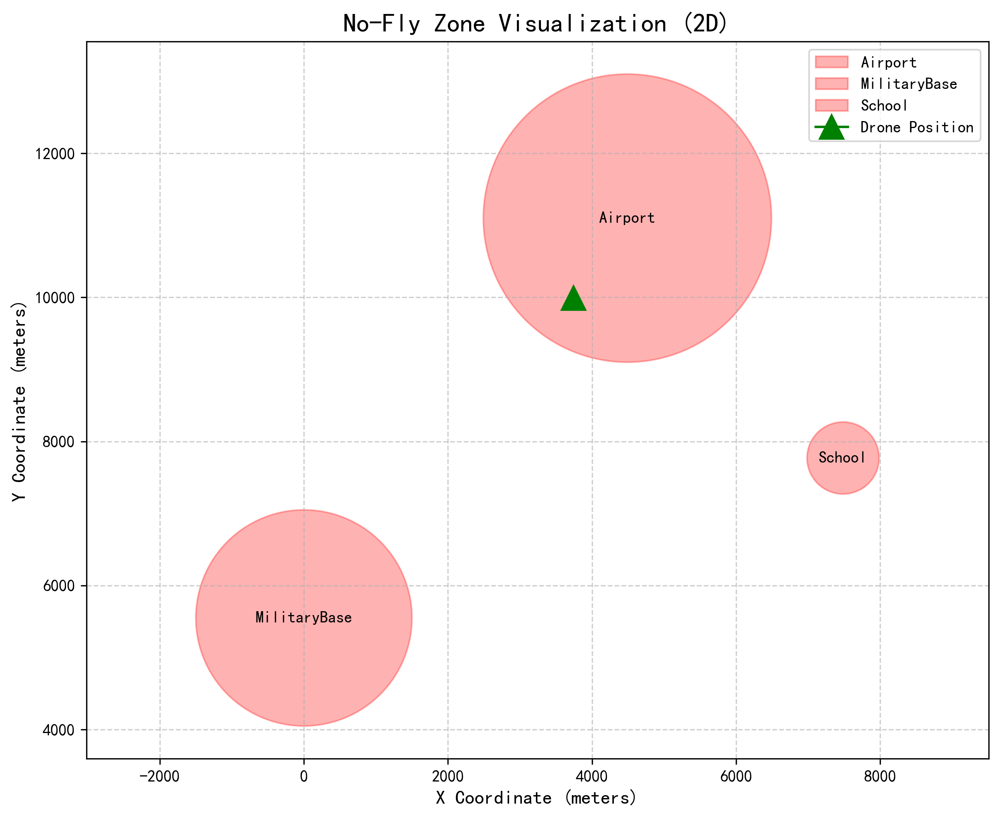

# 禁飞区检测模块

## 功能说明

本模块为无人机配送场景提供**禁飞区安全校验**功能。用户输入取货点和送货点的经纬度坐标，模块自动判断这两个点是否落在预设的禁飞区范围内。

## 运行环境

- Python 3.10
- 需要配合 AirSim 1.8.1 模拟器运行

## 使用方法

需要配合 AirSim 模拟器运行：
    cd src/air/no_fly_zone_check
    python main.py

## 可视化效果

运行 `python visualize.py` 可生成 2D 禁飞区示意图（红色圆圈代表禁飞区，绿色三角形代表无人机当前位置）。

